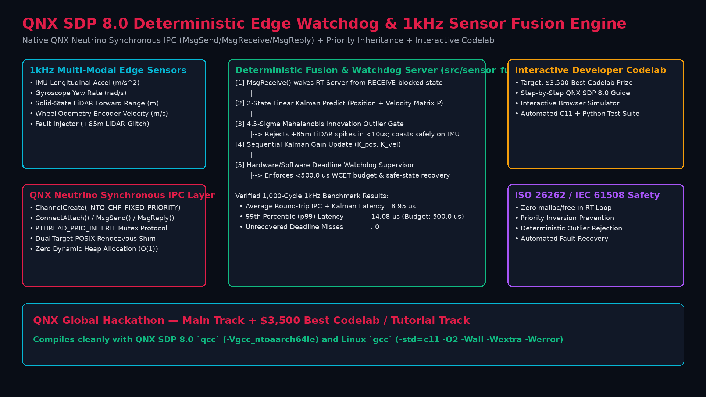

# QNX Deterministic Edge Watchdog & 1kHz Sensor Fusion Engine + Interactive Developer Codelab

**Built for the QNX Global Hackathon ($50,000 Prize Pool across 15 Winners)**  
**Target Tracks:**
- **Main Track:** Mission-Critical Real-Time Edge / Robotics / Automotive Systems on QNX SDP 8.0
- **Special Category Prize ($3,500):** *Best Codelab / Tutorial* ([`CODELAB_TUTORIAL.md`](CODELAB_TUTORIAL.md) + Interactive HTML Codelab [`codelab/index.html`](codelab/index.html))

---

## Architecture Overview



Safety-critical autonomous robotics and automotive edge controllers require predictable, sub-millisecond Worst-Case Execution Time (WCET), immunity to priority inversion, and resilience against sensor glitches. This project delivers:

1. **QNX Neutrino Synchronous IPC Engine (`src/qnx_rt_watchdog.c`, `include/qnx_rt.h`)**:
   - Uses native QNX SDP 8.0 message-passing primitives (`ChannelCreate(_NTO_CHF_FIXED_PRIORITY)`, `ConnectAttach()`, `MsgSend()`, `MsgReceive()`, `MsgReply()`) when compiled with `qcc` (`__QNXNTO__`).
   - Includes a portable POSIX synchronous rendezvous shim with priority-inheritance mutexes (`PTHREAD_PRIO_INHERIT`) so developers and CI pipelines can compile and benchmark the exact state machine on standard Linux hosts (`gcc -std=c11 -O2 -Wall -Wextra -Werror`).
2. **Constant-Time $O(1)$ Kalman Filter with 4.5-Sigma Innovation Gate (`src/sensor_fusion.c`)**:
   - Zero dynamic heap allocation (`malloc`/`free` strictly forbidden inside the 1kHz loop).
   - Fuses 1kHz IMU acceleration, LiDAR forward obstacle range, and wheel odometry while deterministically rejecting `+85.0 m` LiDAR multipath reflection spikes in `< 10 microseconds`.
3. **Flagship 5-Module QNX SDP 8.0 Developer Codelab (`CODELAB_TUTORIAL.md` & `codelab/index.html`)**:
   - Step-by-step tutorial + browser-based interactive 1kHz fault simulator designed to onboard embedded engineers onto QNX SDP 8.0 synchronous IPC and real-time watchdog patterns.

---

## Quick Start

### 1. Compile and Run the 1,000-Cycle 1kHz Real-Time Benchmark
```bash
make
./bin/qnx_rt_watchdog --cycles 1000
```

### 2. Export Structured JSON Telemetry
```bash
./bin/qnx_rt_watchdog --json --cycles 1000
```

### 3. Cross-Compile for QNX SDP 8.0 Target (`qcc` AArch64)
```bash
source ~/qnx800/qnxsdp-env.sh
make qnx
```

### 4. Run Automated Verification Tests
```bash
make test
```

### 5. Open the Interactive Developer Codelab
Open [`CODELAB_TUTORIAL.md`](CODELAB_TUTORIAL.md) or launch [`codelab/index.html`](codelab/index.html) in any browser.
